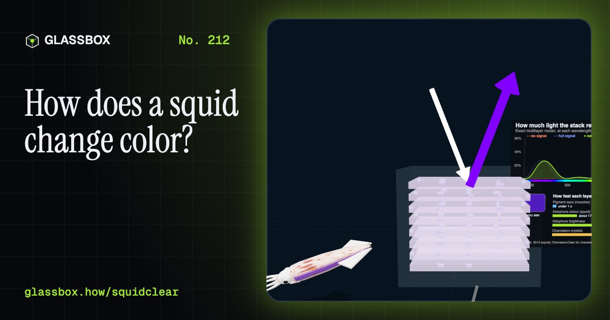
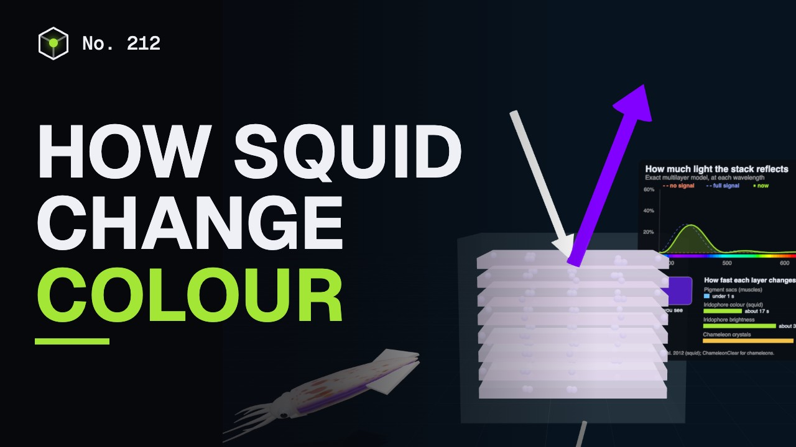
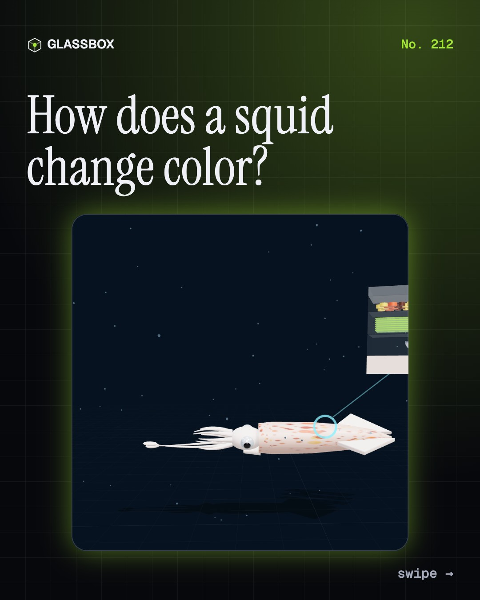
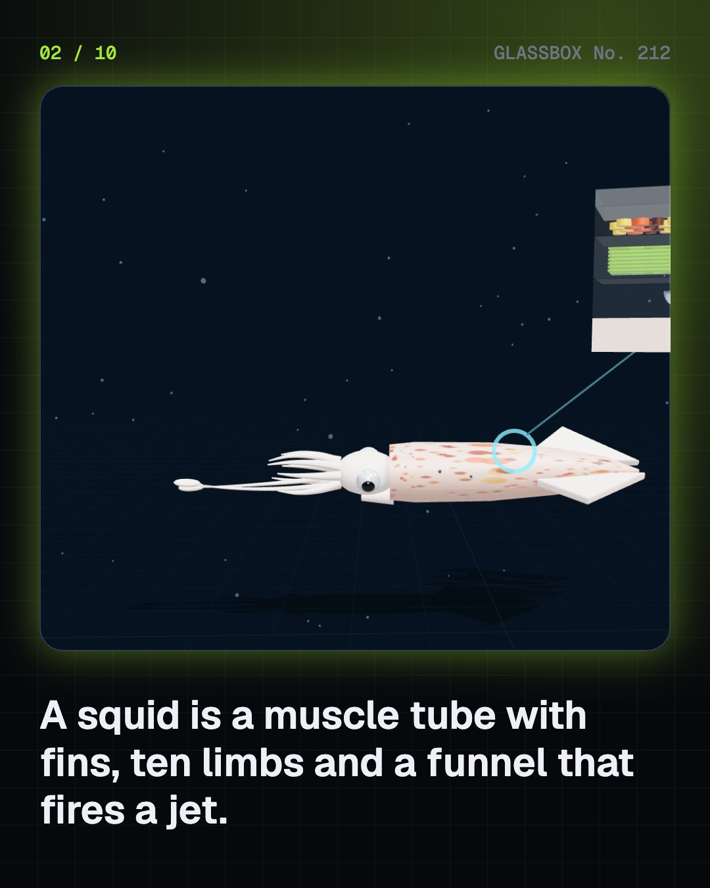
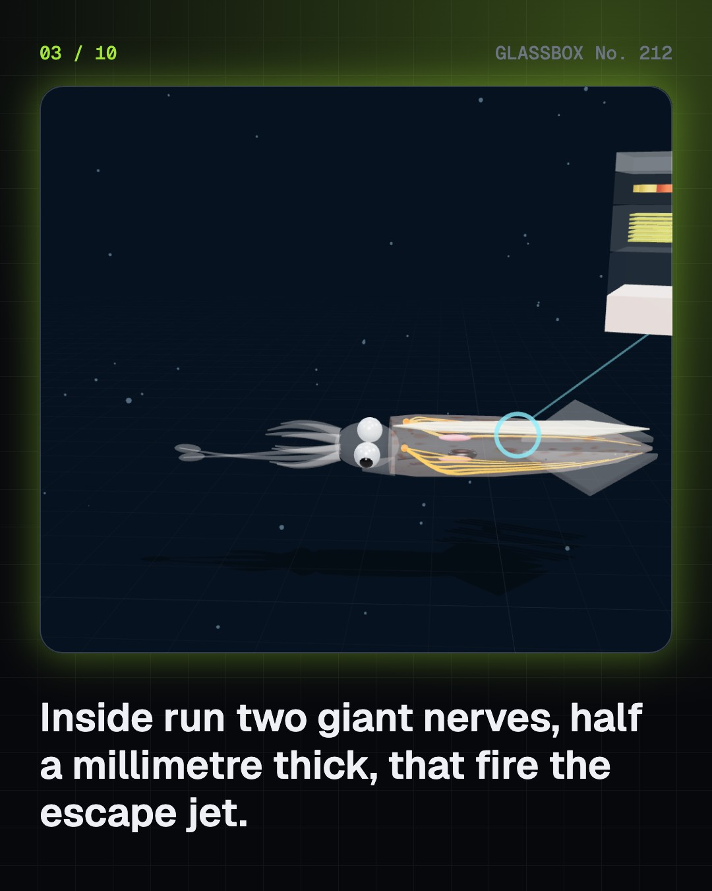
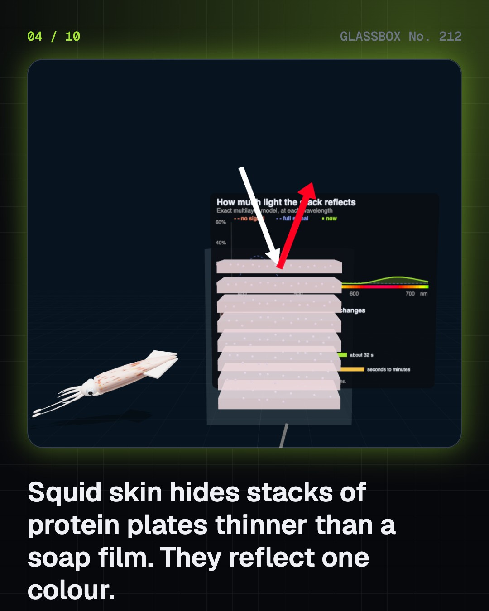

<!-- glassbox:start -->
<!-- Generated from glassbox.json by the Glassbox hub (npm run readme -- squidclear). Edit glassbox.json, not this block. -->
<p align="center"><a href="https://glassbox.how/e/squidclear/"></a></p>

<h1 align="center">SquidClear</h1>

<p align="center"><b>How does a squid change color?</b><br>A squid’s shimmer is not paint. It is light bouncing off stacks of protein plates thinner than a soap film, and a nerve signal can squeeze water out of them to slide the colour from red to blue. Some squid go further and make their own light.</p>

<p align="center"><a href="https://glassbox.how/squidclear/"><b>▶ Play with it</b></a> &nbsp;·&nbsp; <a href="https://glassbox.how/e/squidclear/">Read the 60-second explainer</a> &nbsp;·&nbsp; <a href="https://glassbox.how/squidclear/glassbox/reel.mp4">Watch the 40-second video</a></p>

<p align="center">
  <a href="https://glassbox.how/e/squidclear/"></a>
  <a href="https://glassbox.how/e/squidclear/"></a>
  <a href="LICENSE"></a>
  <a href="LICENSE-CONTENT.md"></a>
  <a href="#privacy"></a>
</p>

## In 60 seconds

1. **A jet-powered tube.** A squid is a muscular mantle with fins, eight arms, two tentacles and a funnel that fires a jet. Two giant nerve fibres fan over the mantle. Its skin stacks pigment sacs over tunable mirrors, and some squid also carry light organs.
2. **Mirrors it can tune.** Iridophores hold stacks of reflectin plates about a tenth of a micrometre thick. Reflections from about eight plates add up for one colour. Acetylcholine from a nerve makes reflectin clump and water leave, so the plates thin and the colour slides from red to blue and gets brighter, over seconds.
3. **Making light.** The Hawaiian bobtail squid farms glowing Vibrio fischeri bacteria in a light organ and matches the moonlight to hide its shadow from below. The firefly squid makes its own blue light, and Humboldt squid flash patterns in the deep.
4. **Jet and ink.** Squeezing the mantle shoots water from the funnel and the squid goes tail first. For an escape the giant axons, thickest where they run furthest, fire the whole mantle at once; the squid turns pale, leaves an ink decoy and jets away.
5. **Squid and people.** India landed about 2.13 lakh tonnes of cephalopods in 2023, roughly half squid, mostly the Indian squid. Frozen squid is a top seafood export. Since 2017 LED light fishing is banned in India’s Exclusive Economic Zone.
6. **How we found out.** Aristotle described squid ink. J. Z. Young found the giant axon in 1936, and Hodgkin and Huxley used it to explain how nerves fire. Glowing squid bacteria revealed quorum sensing, and reflectin is now inspiring new materials.

## Words worth knowing

| Term | Meaning |
|---|---|
| **Iridophore** | A skin cell holding stacks of thin plates that reflect colour by interference. |
| **Reflectin** | The protein, found only in cephalopods, that builds a squid’s reflecting plates. |
| **Thin-film interference** | Light reflected from thin layers adding up for one colour and cancelling for others. |
| **Iridescence** | Colour that shifts as you change the angle you look from. |
| **Chromatophore** | An elastic pigment sac in the skin pulled open by tiny muscles. |
| **Counter-illumination** | Glowing on the belly to match light from above, so no shadow shows from below. |
| **Bioluminescence** | Light made by a living thing through a chemical reaction of a luciferin. |
| **Giant axon** | A nerve fibre about half a millimetre thick that fires a squid’s escape jet. |
| **Jet propulsion** | Moving by squirting a fast stream of water out of the funnel. |

## A short history

**2,350 years from Aristotle’s ink sacs to the nerve that explained every nerve and mirrors built from squid protein.**

- **350 BCE** · Two kinds of squid, and their ink (Aristotle, Athens and Lesbos)
- **1936** · The giant nerve fibre is found (J. Z. Young, Marine Biological Association, Plymouth)
- **1939** · A nerve signal recorded from inside (Alan Hodgkin and Andrew Huxley, Plymouth)
- **1952** · How a nerve fires, worked out (Alan Hodgkin and Andrew Huxley, Cambridge and Plymouth)
- **1963** · A Nobel Prize for the squid’s nerve (Alan Hodgkin, Andrew Huxley and John Eccles, Stockholm)
- **1970** · Bacteria that glow only in a crowd (Kenneth Nealson, Terry Platt and J. Woodland Hastings, Harvard University)
- **2004** · Glowing to hide a shadow, tested (Brian Jones and Michele Nishiguchi, New Mexico State University)
- **2004** · Reflectins are named (W. J. Crookes and colleagues, United States)

The full story, with 27 moments, charts, people and 38 sources: [glassbox.how/e/squidclear/history](https://glassbox.how/e/squidclear/history/). The data lives in [`history.json`](history.json).

## Video and slides

Made with the Glassbox studio from this box's storyboard (`window.glassbox.director`). Free to reuse under CC BY 4.0.

<a href="https://glassbox.how/squidclear/glassbox/video.mp4"></a>

<p><a href="glassbox/slide-1.jpg"></a> <a href="glassbox/slide-2.jpg"></a> <a href="glassbox/slide-3.jpg"></a> <a href="glassbox/slide-4.jpg"></a></p>

| File | What | Size |
|---|---|---|
| [`glassbox/reel.mp4`](https://glassbox.how/squidclear/glassbox/reel.mp4) | Reel / Short, with captions and soundtrack | 1080×1920 |
| [`glassbox/video.mp4`](https://glassbox.how/squidclear/glassbox/video.mp4) | YouTube video, with captions and soundtrack | 1920×1080 |
| `glassbox/slide-1…10.jpg` | Instagram carousel | 1080×1350 |
| `glassbox/thumb.jpg` | YouTube thumbnail | 1280×720 |
| `glassbox/cover.jpg` | Share card and repo social preview | 1200×630 |
| [`glassbox/history-reel.mp4`](https://glassbox.how/squidclear/glassbox/history-reel.mp4) | “History in 10 moments” Reel / Short | 1080×1920 |
| `glassbox/history-slide-*.jpg` | History carousel | 1080×1350 |
| `glassbox/post.json` | Post copy and schedule used by the publish kit | |

## Privacy

This box has no accounts and no ads, and it ships its own fonts and libraries. When you run it yourself it sends nothing anywhere. On glassbox.how, the site's `/bar.js` also loads Glassbox's analytics: **Google Analytics** to count visits (it asks first in the EU, UK and Switzerland, and stays off when your browser sends Global Privacy Control or Do Not Track) and **ClickTrust** to detect bots.

It remembers a few things **in your own browser only**, and never sends them anywhere:

| Browser storage key | What it holds |
|---|---|
| `squidclear.v1` | Which chapters you have opened, your best quiz scores, and sound on or off. |

Exactly what each one sees is at [glassbox.how/privacy](https://glassbox.how/privacy/).

## Licences

- **Code:** [MIT](LICENSE). Use it, change it, ship it.
- **Explanations, text, images and videos** (`glassbox.json`, `glassbox/`): [CC BY 4.0](LICENSE-CONTENT.md). Credit “Glassbox, glassbox.how/e/squidclear”.
- **Third-party parts** keep their own licences: [three.js](https://threejs.org) (MIT), [Geist, Instrument Serif](https://openfontlicense.org) (SIL OFL 1.1).
- The Glassbox name and logo aren't covered by either licence. See the [terms](https://glassbox.how/terms/).

Found a mistake? [Open an issue](https://github.com/bdeeps/squidclear/issues). Corrections happen in public.
<!-- glassbox:end -->

## Run it

It's plain HTML, CSS and JavaScript. No build step and no dependencies. Run locally, it contacts no other website.

```bash
python3 -m http.server 8000
```

Three.js and the fonts ship in `vendor/` and `fonts/`, so it also works offline.

Then open http://localhost:8000.

## How it's built

| File | What |
|---|---|
| `index.html`, `css/app.css` | The page and its styles |
| `js/app.js`, `js/stage.js`, `js/ui.js`, `js/kit.js` | The shared Glassbox 3D engine: chapters, 3D stage, controls, quiz, video director |
| `js/squid.js` | SquidClear's shared parts: the multilayer (transfer-matrix) model of reflectin plate stacks and the spectrum-to-colour code, the counter-illumination, jet and giant-axon models, a procedural squid (longfin, bobtail, firefly, Humboldt), the skin slab, and board and layout helpers |
| `js/chapters/*.js` | One file per chapter: the 3D model, controls, text, key terms, quiz and video scenes |
| `glassbox.json` | Title, question, explainer beats, key terms, browser storage and credits shown on glassbox.how |
| `reel` in each chapter | The storyboard the Glassbox studio records into short videos |
| `glassbox/` | The published video, slides, thumbnail and post copy |
| `fonts/`, `vendor/three/` | Self-hosted Geist and Instrument Serif (SIL OFL 1.1) and three.js (MIT) |
